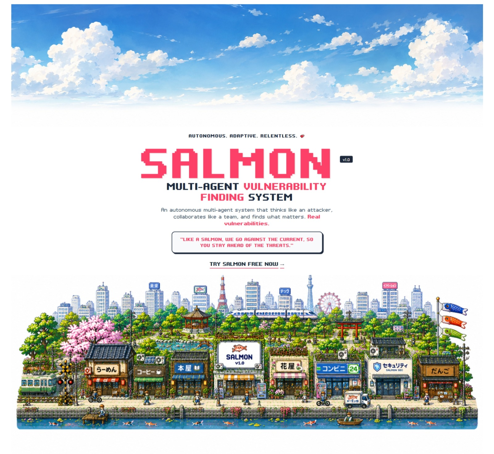
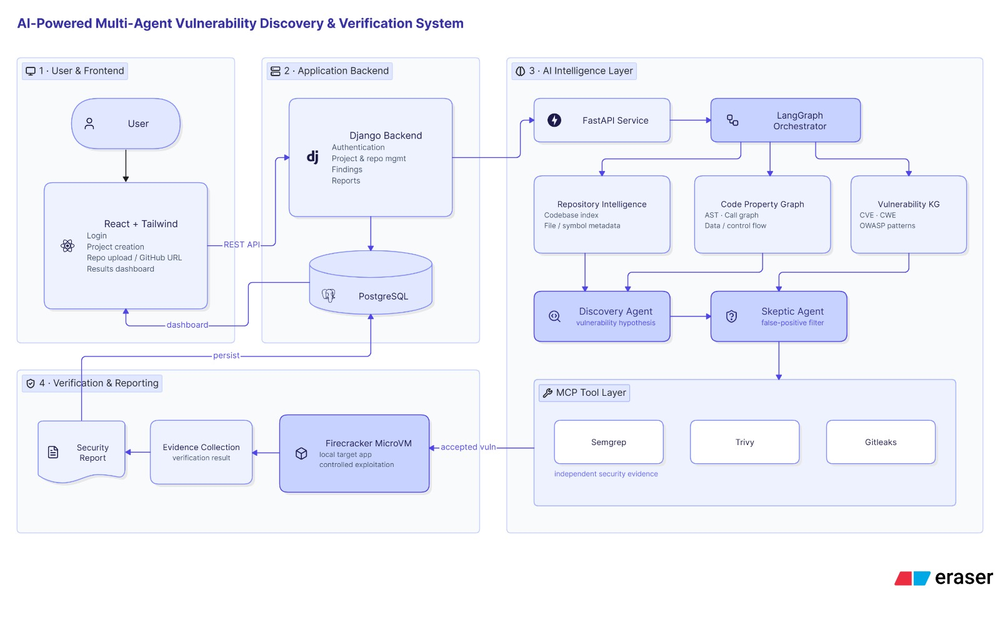
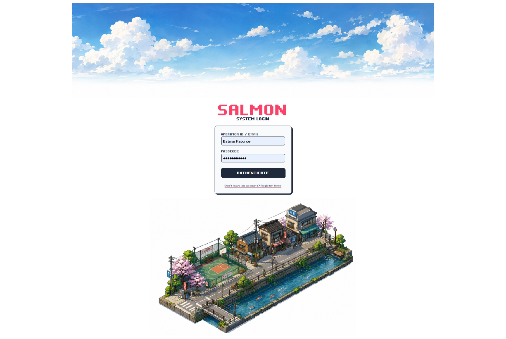
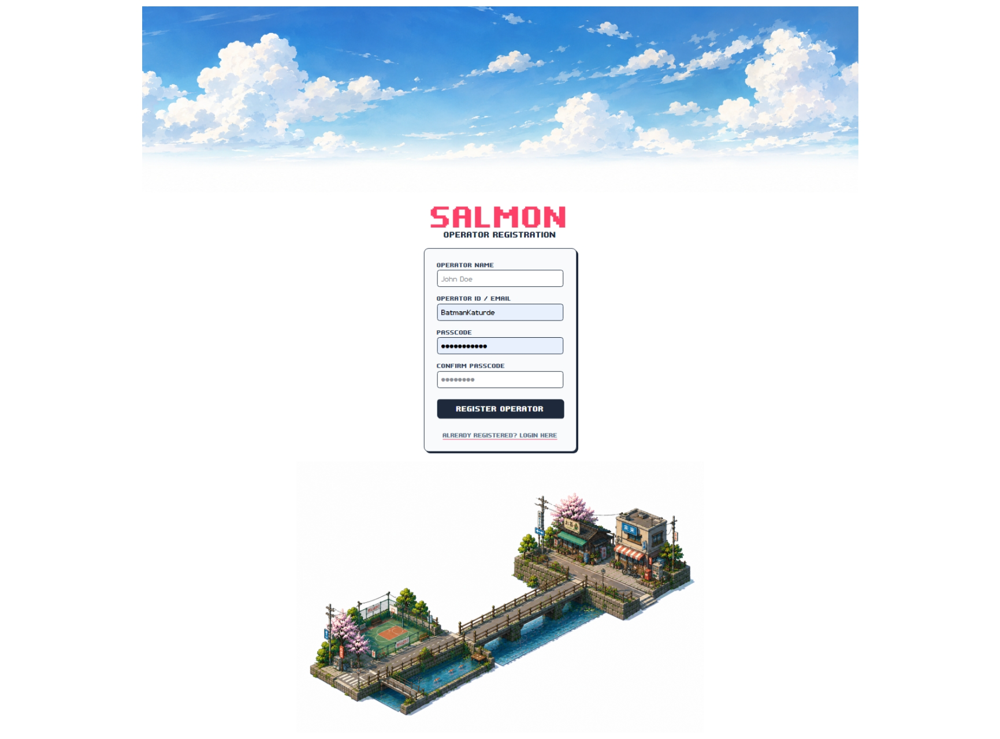

# 🛡️ SALMON — Multi-Agent Vulnerability Finding System

<p align="center">
  
</p>

<p align="center">
  <strong>AI-powered vulnerability research that discovers, challenges, verifies, and reports real security findings.</strong>
</p>

<p align="center">
  
  
  
  
  
  
  
</p>

---

## ⚡ What is SALMON?

**SALMON** is an AI-powered multi-agent vulnerability research system designed to move beyond simple vulnerability prediction.

It combines:

- 📱 **Mobile-First React Framework** ensuring the operator dashboard is fully responsive and accessible anywhere
- 🧠 **Repository Knowledge Graph** for architectural and interprocedural context
- 📚 **CVE/CWE and OWASP-guided security intelligence**
- 🔌 **MCP-connected security tools** such as Semgrep, Trivy, Gitleaks, and targeted analyzers
- 🔎 **Discovery Agent** for identifying potential vulnerabilities
- 🧪 **Skeptic Agent** for independently challenging findings and filtering false positives
- 🧱 **Firecracker MicroVM verification** for controlled reproduction and exploitability testing
- 🤖 **Specialized agents** for code, dependency, reasoning, and verification tasks
- 💰 **Cost-efficient hybrid AI** using local 7–8B models and larger models selectively
- 📄 **Evidence-backed security reports** with classification, attack path, impact, reproduction evidence, and remediation


> **Core philosophy:**  
> **Discover → Challenge → Verify → Reproduce → Report**

---

## 🎯 Problem We Solve

Traditional security assessments can be expensive, slow, and difficult to repeat frequently. AI-based vulnerability detection can reduce analysis effort, but many approaches still depend heavily on a single model, provide limited independent validation, or stop before proving that a vulnerability is actually reachable and exploitable.

SALMON is designed around three major gaps:

### 01 — 💸 Cost & Human Dependency

Professional penetration testing can typically cost **$10,000–$100,000** and take **weeks**, making frequent assessments difficult. Many AI approaches reduce effort but rely on a **single LLM**, increasing dependence on one model's judgment.

### 02 — 🔌 Lack of MCP-Integrated Security Tools

Many AI vulnerability systems rely primarily on LLM reasoning without dynamically connecting to specialized security tools through **MCP (Model Context Protocol)**.

SALMON allows agents to use tools such as:

`Semgrep` · `Trivy` · `Gitleaks` · targeted analysis tools

This provides independent evidence for cross-checking vulnerability hypotheses.

### 03 — 🧩 Context & Verification Gap

Large repositories require architectural and interprocedural context to determine whether a finding is actually reachable.

SALMON goes beyond prediction by attempting to **experimentally verify reachability, reproducibility, and exploitability** in an isolated environment.

---

# 🧬 How SALMON Works

```text
                          ┌─────────────────────┐
                          │     Repository      │
                          └──────────┬──────────┘
                                     │
                                     ▼
                       ┌──────────────────────────┐
                       │ Repository Knowledge Graph│
                       └────────────┬─────────────┘
                                    │
                  ┌─────────────────┼─────────────────┐
                  │                 │                 │
                  ▼                 ▼                 ▼
           ┌────────────┐   ┌──────────────┐   ┌──────────────┐
           │ CVE / CWE  │   │ OWASP /      │   │ MCP Security │
           │ Intelligence│  │ Framework KB │   │ Tools        │
           └──────┬─────┘   └──────┬───────┘   └──────┬───────┘
                  │                 │                  │
                  └─────────────────┼──────────────────┘
                                    ▼
                         ┌─────────────────────┐
                         │   Discovery Agent   │
                         └──────────┬──────────┘
                                    │
                                    ▼
                         ┌─────────────────────┐
                         │    Skeptic Agent    │
                         │  Adversarial Review │
                         └──────────┬──────────┘
                                    │
                     ┌──────────────┴──────────────┐
                     │                             │
                     ▼                             ▼
               ❌ Rejected                  ✅ Survives
                                                   │
                                                   ▼
                                     ┌────────────────────────┐
                                     │ Firecracker MicroVM    │
                                     │ Isolated Verification  │
                                     └───────────┬────────────┘
                                                 │
                                                 ▼
                                    ┌─────────────────────────┐
                                    │ Controlled Reproduction │
                                    │ + Exploitability Test   │
                                    └───────────┬─────────────┘
                                                │
                                                ▼
                                   ┌──────────────────────────┐
                                   │ Evidence-Backed Security │
                                   │ Report                   │
                                   └──────────────────────────┘
```

---

# 🚀 Key Innovations

## 01 — 🤖 AI-Powered Security Tool Use

SALMON equips agents with open-source security tools through **MCP**.

Agents can select tools based on the current vulnerability hypothesis instead of relying only on LLM reasoning.

**Examples**

- 🔍 Semgrep
- 📦 Trivy
- 🔐 Gitleaks
- 🧰 Targeted analysis tools

---

## 02 — 📚 CVE/CWE-Guided Vulnerability Intelligence

SALMON uses:

- CVE patterns
- CWE weakness classes
- OWASP knowledge
- Framework-specific vulnerabilities
- Established vulnerability patterns

This guides agents toward known security patterns and improves security-aware reasoning.

---

## 03 — ⚔️ Dual-Agent Adversarial Reasoning

Instead of asking one model to decide whether its own finding is correct, SALMON separates the responsibilities.

### 🔎 Discovery AI

Finds potential vulnerabilities and builds the initial hypothesis.

### 🧠 Skeptic AI

Independently challenges the finding by:

- Searching for contradictory evidence
- Questioning assumptions
- Checking reachability
- Looking for mitigating controls
- Attempting to prove it is a **false positive**

Only findings that survive the adversarial stage continue toward verification.

---

## 04 — 🔥 Firecracker MicroVM Verification

Potential findings that survive filtering are tested inside an isolated **Firecracker MicroVM**.

The purpose is to establish actual execution evidence and determine whether a suspected issue is:

✅ Reachable  
✅ Reproducible  
✅ Exploitable

This helps bridge the gap between **"the code looks vulnerable"** and **"the vulnerability can actually be demonstrated."**

---

## 05 — 🧩 Specialized Multi-Agent Analysis

SALMON can divide analysis into specialized responsibilities:

| Agent Role | Responsibility |
|---|---|
| 🔎 Discovery | Identify potential vulnerabilities |
| 🧠 Skeptic | Challenge findings and reduce false positives |
| 💻 Code Analysis | Analyze source and program flow |
| 📦 Dependency Analysis | Inspect dependency-related risk |
| 🛡️ Vulnerability Reasoning | Map patterns to security weaknesses |
| 🧪 Verification | Validate surviving findings |

This enables focused reasoning across different frameworks and vulnerability classes.

---

## 06 — 💰 Cost-Efficient AI Architecture

SALMON is designed around a hybrid model strategy.

```text
                  ┌──────────────────────┐
                  │     Analysis Task    │
                  └──────────┬───────────┘
                             │
                ┌────────────┴────────────┐
                │                         │
                ▼                         ▼
        ┌────────────────┐       ┌──────────────────┐
        │ Local 7–8B     │       │ Larger API Model │
        │ Open Models    │       │                  │
        └───────┬────────┘       └────────┬─────────┘
                │                         │
         Routine analysis         Complex reasoning
                │                         │
                └────────────┬────────────┘
                             ▼
                    Evidence + Decision
```

The goal is to balance:

**Accuracy · Privacy · Cost · Local Execution**

---

## 07 — 📄 Industry-Level Security Reporting

SALMON turns validated findings into structured security reports containing:

- 🏷️ CVE/CWE classification
- 📍 Affected component
- 🚨 Severity
- 🧭 Attack path
- 🧪 Reproduction evidence
- 💥 Impact
- 🛠️ Remediation

The goal is to provide security results that developers and security teams can act on immediately.

---

# 🏗️ Architecture

<p align="center">
  
</p>

---

# 🖥️ Interface Preview

## 🏠 Landing Page

<p align="center">
  
</p>

## 🔐 Login

<p align="center">
  
</p>

## 👤 Operator Registration

<p align="center">
  
</p>

---

# 🧰 Technology Stack

## Frontend

| Technology | Purpose |
|---|---|
| ⚛️ React | **Core Framework** for the frontend application |
| 📱 Mobile-First | **Design approach** ensuring responsiveness on all devices |
| ⚡ Vite | Development and build tooling |
| 🎨 Tailwind CSS | UI styling and responsive utility classes |
| 🧭 React Router | Client-side routing |

## Backend

| Technology | Purpose |
|---|---|
| 🐍 Django | Core application backend |
| 🔗 Django REST Framework | REST APIs |
| 🔑 SimpleJWT | JWT authentication |
| 🚀 FastAPI | AI/ML intelligence service |
| 📦 uv | Python dependency management |

## Security & AI

| Technology / Concept | Purpose |
|---|---|
| 🔌 MCP | Connect AI agents to security tools |
| 🔍 Semgrep | Static security analysis |
| 📦 Trivy | Dependency/container security |
| 🔐 Gitleaks | Secret detection |
| 🔥 Firecracker | Isolated MicroVM verification |
| 📚 CVE/CWE | Vulnerability intelligence |
| 🧠 Knowledge Graph | Repository context and relationships |
| 🤖 Multi-Agent System | Independent discovery and validation |

---

# 🔐 Authentication

SALMON uses JWT-based operator authentication.

### Current API

```http
POST /api/auth/register/
POST /api/auth/login/
POST /api/auth/refresh/
GET  /api/auth/me/
POST /api/auth/logout/
```

### Authentication Flow

```text
React (Mobile-First)
  │
  ├── Register ───────────────► Django
  │
  ├── Login ─────────────────► Django
  │                              │
  │                              ▼
  │                         JWT Access
  │                         JWT Refresh
  │                              │
  │◄─────────────────────────────┘
  │
  ├── Bearer Token ──────────► Protected API
  │
  └── Refresh Token ─────────► New Access Token
```

Protected frontend routes require an authenticated operator.

---

# 📁 Project Structure

```text
SALMON/
│
├── .gitignore
├── README.md
│
├── backend/
│   └── core/
│       ├── accounts/
│       │   ├── models.py
│       │   ├── serializers.py
│       │   ├── views.py
│       │   ├── urls.py
│       │   └── admin.py
│       │
│       ├── core/
│       │   ├── settings.py
│       │   ├── urls.py
│       │   └── ...
│       │
│       ├── manage.py
│       ├── pyproject.toml
│       └── uv.lock
│
├── frontend/
│   ├── public/
│   │   └── favicon.png
│   │
│   ├── src/
│   │   ├── assets/
│   │   ├── context/
│   │   ├── pages/
│   │   ├── routes/
│   │   ├── services/
│   │   ├── UI/
│   │   ├── App.jsx
│   │   ├── main.jsx
│   │   └── index.css
│   │
│   ├── package.json
│   └── vite.config.js
│
└── screenshots/
    ├── architecure.png
    ├── landing_page.png
    ├── login_page.png
    └── register_page.png
```

---

# 🔄 End-to-End Security Pipeline

```text
📂 Repository
      │
      ▼
🧠 Knowledge Graph
      │
      ├────────► 📚 CVE / CWE / OWASP
      │
      └────────► 🔌 MCP Security Tools
                       │
                       ▼
                 🔎 Discovery
                       │
                       ▼
                 🧠 Skeptic
                       │
                       ▼
                 ✅ Valid Finding
                       │
                       ▼
                🔥 Firecracker
                       │
                       ▼
              🧪 Reproduction
                       │
                       ▼
             📄 Security Report
```

---

# 📊 What Makes SALMON Different?

| Traditional SAST | Single-LLM Analysis | SALMON |
|---|---:|---:|
| Rule-based analysis | ✅ | ✅ |
| Architectural context | Limited | ✅ Knowledge Graph |
| CVE/CWE guidance | Limited | ✅ |
| Dynamic security tools | Limited | ✅ MCP |
| Independent challenge | ❌ | ✅ Skeptic Agent |
| Experimental verification | ❌ | ✅ MicroVM |
| Reproduction evidence | Limited | ✅ |
| Multi-agent reasoning | ❌ | ✅ |
| Structured security reporting | ✅ | ✅ |
| Local model option | N/A | ✅ |

---

# 🛣️ Roadmap

### ✅ Foundation

- [x] React/Vite frontend (Mobile-First)
- [x] Django backend
- [x] JWT authentication
- [x] Operator registration
- [x] Operator login
- [x] Protected routes
- [x] Django–React development proxy
- [x] Initial UI and architecture

### 🚧 In Development

- [ ] Repository knowledge graph
- [ ] Discovery Agent
- [ ] Skeptic Agent
- [ ] MCP tool orchestration
- [ ] CVE/CWE knowledge pipeline
- [ ] Firecracker verification workflow
- [ ] Evidence collection
- [ ] Automated security reports

### 🔮 Planned

- [ ] More specialized analysis agents
- [ ] Broader vulnerability-class coverage
- [ ] Advanced evidence correlation
- [ ] Improved model routing
- [ ] Production packaging / deployment workflow

---

# 🚀 Getting Started

## 1. Clone

```bash
git clone https://github.com/SahilKaturde/SALMON---Multi-Agent-Vulnerability-Finding-System.git
cd SALMON---Multi-Agent-Vulnerability-Finding-System
```

## 2. Backend

```bash
cd backend/core
uv sync
uv run manage.py migrate
uv run manage.py runserver
```

The Django backend runs at:

```text
http://127.0.0.1:8000/
```

## 3. Frontend

Open another terminal:

```bash
cd frontend
npm install
npm run dev
```

The Vite development server runs at:

```text
http://localhost:5173/
```

---

# 🔒 Responsible Use

SALMON is intended for **authorized security research, defensive testing, and controlled vulnerability validation**.

Only analyze repositories and systems you are authorized to test. MicroVM-based verification and exploit reproduction should remain isolated and controlled.

---

# 👥 Project

**SALMON — Multi-Agent Vulnerability Finding System**

Built around the idea that a strong vulnerability finding should be more than a prediction:

> **It should survive independent scrutiny and be backed by evidence.**

---

<p align="center">
  <strong>Discover. Challenge. Verify. Reproduce. Report.</strong>
</p>

<p align="center">
  🛡️ SALMON • Multi-Agent Security Research
</p>

---
**Note:** The SALMON frontend relies on the **React framework** and follows a **Mobile-First** methodology, ensuring smooth operation across all screens and device types.
